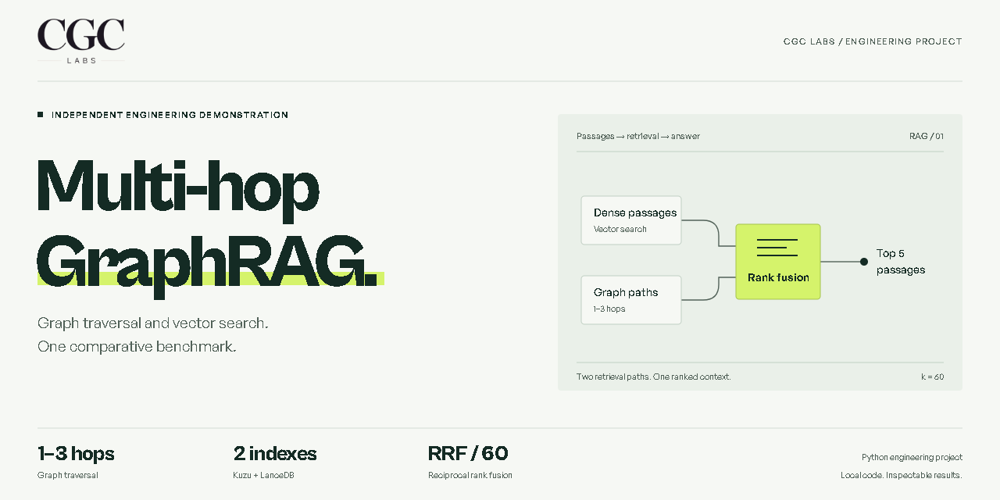
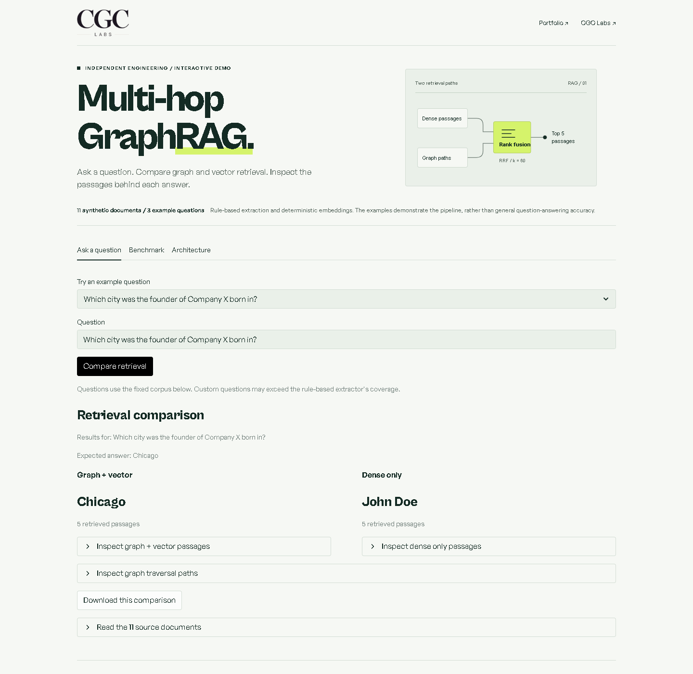

# Multi-Hop GraphRAG

An interactive Streamlit project that combines a knowledge graph with vector retrieval to answer questions across multiple documents. Kuzu stores the relationships. LanceDB finds relevant passages. Compare both retrieval paths and inspect the evidence behind an answer.

The report and repository artwork use the visual system of [CGC Labs](https://cgclabs.org/), my consulting firm. This remains an independent engineering demonstration.

[Run the Streamlit app](docs/STREAMLIT.md) · [Architecture & schema](docs/ARCHITECTURE.md) · [Portfolio case study](docs/PORTFOLIO.md)

## The problem

The passage that mentions a company may name its founder. A different passage may name the founder's birthplace. A useful answer needs both.

```text
Company X  ── founded by ──▶  John Doe  ── born in ──▶  Chicago
```

This project keeps those connections alongside the passage index. It retrieves the graph neighborhood, combines it with vector search, and selects an answer from the resulting evidence.

## Pipeline

1. Split documents into overlapping passages with deterministic chunk IDs.
2. Extract entities and relationships with a rule-based parser.
3. Canonicalize entity names and write graph and vector indexes.
4. Link query mentions to seed entities and traverse up to three hops.
5. Combine graph and vector candidates with reciprocal rank fusion.
6. Extract an answer span and compare it with the expected answer.

The default run uses deterministic hash-projection embeddings and heuristic answer extraction. It runs without a model download or an API key. Optional model-provider adapters exist in the source; the published example does not use them.

## Engineering and evaluation

This independent project connects data engineering with information-retrieval evaluation.

| Area | Implemented behavior | Evidence |
| :--- | :--- | :--- |
| Ingestion and modeling | Deterministic passage IDs connect typed entities, relationships, and vector records across two stores. | [Storage schema](docs/ARCHITECTURE.md) |
| Runtime controls | Input validation, bounded concurrency, isolated temporary stores, and explicit resource cleanup support interactive queries. | [Demo execution](src/demo.py) and [tests](tests/test_demo.py) |
| Comparative evaluation | The graph-and-vector pipeline and dense baseline report retrieval recall, MRR, exact match, and token F1. | [Evaluation code](src/evaluation.py) and [run records](docs/example-results.json) |
| Error analysis | Regression tests cover entity-ordering errors, irrelevant path extensions, and context headings entering answer candidates. | [Extraction tests](tests/test_extraction.py) and [answer tests](tests/test_synthesis.py) |

The local suite contains 111 passing tests, including six Streamlit AppTest flows. These checks establish the behaviors exercised; the three synthetic benchmark cases do not establish general accuracy. See [verification scope](docs/VERIFICATION.md).

## Benchmark results

The included demonstration uses **11 documents and three synthetic questions**: two two-hop questions and one three-hop question.

| Metric | Graph + vector | Vector baseline |
| :--- | ---: | ---: |
| All-support retrieval recall | 100% | 0% |
| Answer exact match | 100% | 0% |
| Answer token F1 | 100% | 0% |

These are smoke-test results on the built-in examples, not a MuSiQue validation score or evidence of production performance. Both systems use the same embedding provider and heuristic generator; only the graph system supplies traversal paths.

[Inspect the complete results](docs/example-results.json) or open the [standalone HTML report](docs/example-report.html) locally.



## Run locally

Use Python 3.11 for the Streamlit deployment. Run these commands from the project directory.

```bash
python -m venv .venv
```

Activate the environment with `.venv\Scripts\Activate.ps1` in PowerShell or `source .venv/bin/activate` in a POSIX shell.

```bash
python -m pip install -r requirements.txt
python -m streamlit run streamlit_app.py
```

Open the local URL printed by Streamlit. Choose a built-in question or ask about the included corpus. Compare answers, inspect graph paths and retrieved passages, and run the three-question benchmark.

The app uses the fixed synthetic corpus. It requires no API key, model download, or uploaded document. For hosting and the existing portfolio integration pattern, see [Streamlit deployment and embedding](docs/STREAMLIT.md).

To run the tests:

```bash
python -m pip install -e ".[app,dev]"
python -m pytest
```

The command-line benchmark remains available with an isolated database directory:

```bash
python scripts/run_musique_eval.py --storage-dir ./data_store/demo-store
```

Open `data_store/report.html` in a browser. Its data, artwork, and interactions are embedded. Brand fonts load from Fontshare when available, with system sans fallbacks offline. `data_store/results.json` preserves both systems' results. Use `--report-file` and `--results-file` to choose other export paths.

Each benchmark rebuilds the selected storage directory. Use a disposable path, as shown above.

For a local MuSiQue-format dataset, add `--data-file path/to/validation.jsonl`. The `--use-hf` option loads the configured Hugging Face dataset and requires network access. Results from those modes must be evaluated separately from this demonstration.

## Repository map

```text
streamlit_app.py    Interactive app entry point
.streamlit/        Theme and server configuration
src/
  demo.py          Bounded demo queries and benchmark execution
  streamlit_ui.py  Native app views and evidence inspection
  chunker.py       Passage boundaries and deterministic IDs
  extraction.py    Rule extraction and entity canonicalization
  storage.py       Kuzu graph and LanceDB vector stores
  retrieval.py     Seed linking, graph traversal, and rank fusion
  synthesis.py     Answer extraction and optional model adapters
  evaluation.py    Retrieval and answer metrics
  pipeline.py      End-to-end orchestration
  reporting.py     Validated results and terminal output
  report_html.py   Standalone HTML report
scripts/
  run_musique_eval.py
tests/             Unit and local integration tests
docs/              Architecture, example report, and portfolio copy
```

See the [schema and design decisions](docs/ARCHITECTURE.md) for the stored fields, retrieval defaults, and current limits.

The [JSON results schema](docs/results.schema.json) defines the versioned export format.

## Scope

This repository is an independent engineering demonstration. It does not implement authentication, tenant isolation, or production operations. Extraction rules cover a limited set of relations. The reported faithfulness metric measures token overlap with context; it is not independent factual verification.

The [original specification](SPECIFICATION.md) records the broader design. The source and executable examples describe the current implementation.

For reuse in a portfolio or GitHub listing, see the [project copy](docs/PORTFOLIO.md) and [repository metadata](docs/GITHUB.md).
