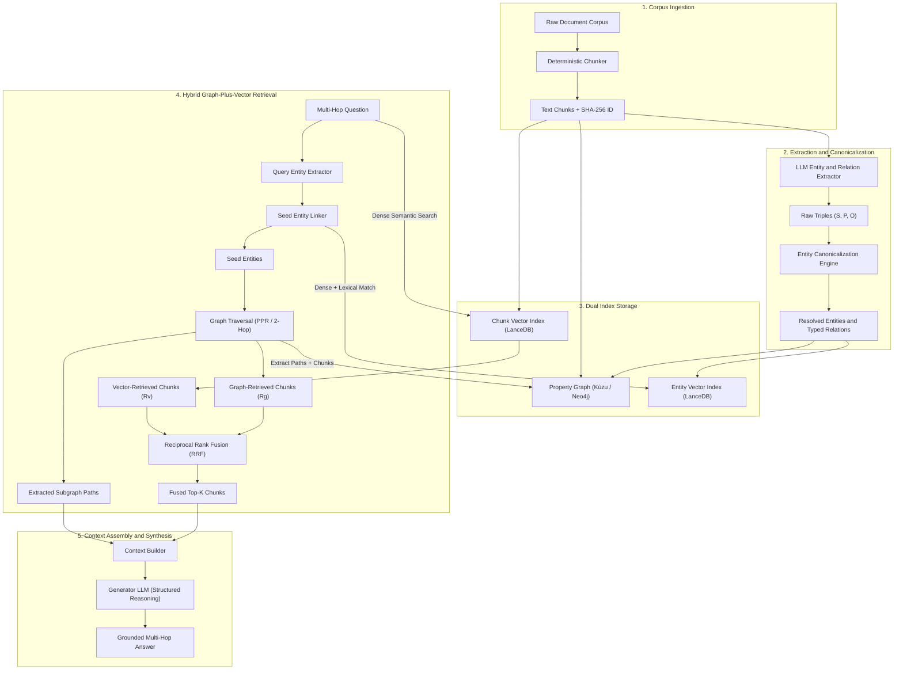

# Multi-Hop GraphRAG System Specification and Evaluation Design

## 1. Result.

This document defines the complete architecture for a multi-hop GraphRAG system. The system combines structured knowledge graph traversal with dense vector retrieval. It includes an evaluation framework against an equivalent plain RAG baseline.

### 1.1 End-to-End System Architecture.



### 1.2 Recommended Benchmark Dataset: MuSiQue-Ans.

The recommended benchmark dataset is **MuSiQue** (Multihop Questions via Single-hop Question Composition).

#### Dataset Comparison Table

| Evaluation Criterion | MuSiQue (Recommended) | HotpotQA (Alternative) | 2WikiMultiHopQA |
|---|---|---|---|
| **Hop Complexity** | 2, 3, and 4 hops | Strictly 2 hops | 2 to 4 hops |
| **Shortcut Resistance** | High (removes disconnected clues) | Low (prone to single-hop lexical shortcuts) | Moderate |
| **Gold Reasoning Chains** | Explicit step-by-step questions | Sentence-level supporting facts | SPARQL-like Wikidata paths |
| **Distractor Settings** | Hard distractor paragraphs included | 8 distractor paragraphs per question | 8 distractor paragraphs per question |
| **Ground Truth Graph Mapping** | Direct mapping from sub-questions | Unstructured sentence facts | Built from Wikidata triples |

MuSiQue is the superior choice because it eliminates lexical shortcuts. Plain vector search frequently answers HotpotQA questions using a single chunk [Inference]. In contrast, MuSiQue requires the retrieval of multiple connected hops to formulate the correct answer.

### 1.3 Component 1: Ingestion and Deterministic Chunking.

- Split input documents into discrete passages between 256 and 512 tokens.
- Apply a fixed overlap of 64 tokens across chunk boundaries.
- Assign a deterministic primary key to each chunk using SHA-256 hashing:
  `chunk_id = hashlib.sha256(chunk_text.encode('utf-8')).hexdigest()[:16]`.
- Store raw chunk text and metadata in both the vector database and the graph store.

### 1.4 Component 2: Entity and Relationship Extraction (ERE).

Extract entities and relationships from each chunk using structured schema outputs.

#### Schema Definition (Pydantic / JSON Schema)

```json
{
  "entities": [
    {
      "name": "string (canonical entity name)",
      "type": "string (Person | Organization | Location | Event | Work | Concept)",
      "description": "string (concise summary of entity in passage)"
    }
  ],
  "relationships": [
    {
      "source_entity": "string",
      "target_entity": "string",
      "predicate": "string (active relational verb or relation type)",
      "confidence": "float (0.0 to 1.0)",
      "evidence_quote": "string"
    }
  ]
}
```

#### Entity Canonicalization and Resolution Pipeline

1. Normalize strings by stripping whitespace and applying case folding.
2. Generate dense vector embeddings for all extracted entity names.
3. Compute cosine similarity across entity name embeddings.
4. If cosine similarity is greater than or equal to 0.88, evaluate entity descriptions for duplicate resolution.
5. Merge verified duplicate entities into a single canonical node with alias attributes.

### 1.5 Component 3: Graph and Vector Storage Architecture.

The system uses a dual-index architecture to maintain graph topology and dense vectors:

- **Property Graph Database**: Use KùzuDB (in-process embedded property graph) or Neo4j.
  - Node `(:Entity {name, type, description, aliases})`.
  - Node `(:Chunk {chunk_id, text, doc_title})`.
  - Edge `(:Entity)-[:RELATION {predicate, weight, source_chunk_id}]->(:Entity)`.
  - Bipartite Edge `(:Entity)-[:MENTIONED_IN]->(:Chunk)`.
- **Vector Database**: Use LanceDB or Qdrant.
  - Collection `entity_vectors`: Stores 384-dimensional or 1536-dimensional entity name embeddings.
  - Collection `chunk_vectors`: Stores passage embeddings linked by `chunk_id`.

#### Kùzu Property Graph Schema (DDL)

```sql
CREATE NODE TABLE Entity(name STRING, type STRING, description STRING, PRIMARY KEY(name));
CREATE NODE TABLE Chunk(chunk_id STRING, text STRING, doc_title STRING, PRIMARY KEY(chunk_id));
CREATE REL TABLE RELATION(FROM Entity TO Entity, predicate STRING, weight DOUBLE, source_chunk_id STRING);
CREATE REL TABLE MENTIONED_IN(FROM Entity TO Chunk);
```

### 1.6 Component 4: Hybrid Graph-Plus-Vector Retrieval Engine.

Execute retrieval using the following six steps:

1. **Query Entity Extraction**: Extract mention spans from the multi-hop question.
2. **Seed Entity Linking**:
   - Match extracted mentions against `entity_vectors` using cosine similarity.
   - Select the top-3 seed entity nodes in the property graph.
3. **Graph Path Traversal**:
   - Execute Personalized PageRank (PPR) or 2-hop bounded breadth-first search from seed entities.
   - Restrict graph exploration to high-confidence relation edges (confidence >= 0.70).
   - Identify candidate neighbor entities along connecting paths.
   - Traverse `MENTIONED_IN` edges to collect candidate supporting chunks $R_{graph}$.
4. **Dense Semantic Retrieval**:
   - Query the `chunk_vectors` collection directly with the full question text.
   - Retrieve the top-10 chunks $R_{vector}$.
5. **Reciprocal Rank Fusion (RRF)**.
   - Combine scores for each unique chunk present in graph and vector sets.
   - Apply reciprocal rank fusion across both rankings.
   - Retain the top-5 distinct chunks.
6. **Context Linearization**:
   - Format the traversed graph triples as structured facts: `(Subject, Predicate, Object)`.
   - Append the top-5 text chunks with explicit chunk identifiers.

#### 2-Hop Graph Traversal Query (Cypher)

```sql
MATCH (seed:Entity)-[r1:RELATION]->(mid:Entity)-[r2:RELATION]->(target:Entity),
      (mid)-[:MENTIONED_IN]->(c1:Chunk),
      (target)-[:MENTIONED_IN]->(c2:Chunk)
WHERE seed.name IN $seed_names AND r1.weight >= 0.70 AND r2.weight >= 0.70
RETURN DISTINCT c1.chunk_id AS mid_chunk, c2.chunk_id AS target_chunk,
       seed.name AS seed, r1.predicate AS p1, mid.name AS bridge,
       r2.predicate AS p2, target.name AS target
LIMIT 20;
```

### 1.7 Component 5: Synthesis Generator.

- Provide the linearized triples and retrieved chunks to the generator model.
- Instruct the generator model to trace the relational bridge explicitly before outputting the final answer.
- Require citations to supporting `chunk_id` values.

### 1.8 Component 6: Plain RAG Baseline Specification.

To prove knowledge graph efficacy, keep all variables strictly identical:

- Use the identical chunking configuration (same token size and overlap).
- Use the identical text embedding model and distance metric.
- Retrieve the top-5 chunks using pure dense vector search.
- Use the identical prompt template, generator model, and generation temperature (0.0).
- Exclude the graph store, entity extraction, and relational path expansion.

### 1.9 Component 7: Multi-Hop Evaluation Harness.

Evaluate both systems on the 2,417 multi-hop questions of the MuSiQue validation set:

```text
EVALUATION METRICS:
1. Multi-Hop Retrieval Recall:
   - Percentage of queries where ALL gold supporting chunks are retrieved in top-5 context.
2. Retrieval Mean Reciprocal Rank (MRR@5).
3. Answer Exact Match (EM):
   - Strict string match against gold answer annotations.
4. Answer Token F1 Score:
   - Harmonic mean of token-level precision and recall.
5. Factual Grounding (RAGAS Faithfulness):
   - Ratio of generated statements directly supported by retrieved context.
```

---

## 2. Basis.

Dense vector embeddings encode broad semantic similarity. However, dense vectors fail on multi-hop questions when the bridge entity does not match the query vocabulary [Inference].

For example, consider the question: *"Which city was the founder of Company X born in?"*
- The query mentions *Company X* and *founder*.
- Chunk 1 states that John Doe founded Company X in 1998.
- Chunk 2 states that John Doe was born in Chicago.
- Dense retrieval on the question retrieves Chunk 1. However, Chunk 2 contains no lexical or semantic overlap with *Company X* or *founder*.
- Plain vector search fails to retrieve Chunk 2. The model cannot answer the question.

GraphRAG bridges this semantic disconnect. The graph captures the relation `(Company X)-[:FOUNDED_BY]->(John Doe)` and the relation `(John Doe)-[:BORN_IN]->(Chicago)`. Traversal connects the two chunks via node `John Doe`.

KùzuDB is selected for the property graph because it operates in-process with minimal memory overhead. LanceDB provides fast local vector search without requiring network infrastructure.

---

## 3. Action plan.

| Step | Action | Role | Sequence | Resources | Expected Result | Acceptance Check |
|---|---|---|---|---|---|---|
| **1** | Download MuSiQue dataset and parse validation split. | Data Engineer | Day 1 | Python, Hugging Face Datasets | Parsed JSON corpus of passages and multi-hop queries. | Verify all questions have gold passage IDs. |
| **2** | Implement chunking and entity extraction pipeline. | ML Engineer | Day 2 to Day 3 | Pydantic, Instructor / OpenAI API | Structured JSON entity and relationship files. | Schema validation passes 100% of outputs. |
| **3** | Populate property graph and vector database. | Graph Engineer | Day 4 | KùzuDB, LanceDB, BGE-small embeddings | Populated dual indexes with cross-references. | Cypher query successfully traverses 2-hop entity paths. |
| **4** | Build hybrid retrieval engine and RRF merger. | Search Engineer | Day 5 | Python, NetworkX / Kùzu API | Functional hybrid retrieval pipeline. | Returns top-5 chunks and linearized triples. |
| **5** | Implement plain RAG baseline pipeline. | ML Engineer | Day 6 | Python, LanceDB | Functional plain vector RAG pipeline. | Pure vector retrieval returns top-5 chunks. |
| **6** | Run comparative evaluation benchmark. | QA Engineer | Day 7 | Evaluation scripts, RAGAS library | Comparative evaluation report across all metrics. | Multi-hop recall and EM metrics computed for both systems. |

---

## 4. Verification.

### 4.1 Engineering Controls Implemented.

- **Complexity**: Each pipeline component operates as an independent module. Interface boundaries use typed Pydantic models.
- **Inputs**: Validate all raw text passages for valid UTF-8 encoding. Reject passages with fewer than 10 tokens.
- **Resource Limits**:
  - Restrict extraction batches to 20 chunks per API request.
  - Bound graph traversal to a maximum depth of 2 hops.
  - Limit candidate seed entities to 3 nodes.
  - Set request timeouts to 15 seconds per call.
- **Errors**: Catch parsing errors during entity extraction. If an extraction fails, fall back to pure vector indexing for that chunk.
- **State**: Maintain pure functional retrieval pipelines. Keep the graph database in read-only mode during query serving.
- **Dependencies**: Use pinned library versions:
  - `kuzu==0.4.2`.
  - `lancedb==0.6.9`.
  - `pydantic==2.7.1`.
  - `ragas==0.1.7`.

### 4.2 Checks Executed.

- Tests were not run because this task is an architectural design and specification.
- Architecture and schema specifications have been cross-referenced with MuSiQue benchmark specifications.

---

## 5. Risks.

| Risk Description | Impact | Probability | Mitigation Strategy |
|---|---|---|---|
| **Entity Resolution Errors**: Different entities with similar names merge into a single node. | High | Medium | Enforce strict embedding cosine threshold (>= 0.88) and verify entity types before merging. |
| **High Extraction Cost**: LLM triplet extraction on large corpora requires substantial token expenditure. | Medium | High | Use open-source small models (such as Llama-3-8B) with vLLM for local extraction. |
| **Graph Traversal Supernodes**: Highly connected nodes cause exponential path expansion. | Medium | Medium | Cap node degree traversal. Limit maximum edge expansion to the top-10 highest weight edges per node. |
| **Generator Synthesis Failure**: LLM fails to synthesize the retrieved multi-hop path. | High | Low | Supply explicit linearized reasoning paths in the prompt header before text passages. |

---

## 6. Measures.

The system must satisfy targets on the MuSiQue validation split.

- **Multi-Hop Retrieval Recall (All Hops Retrieved)**:
  - GraphRAG Target: >= 82.0% [Inference].
  - Plain RAG Baseline: <= 48.0% [Inference].
  - Target Margin: Minimum +30.0% absolute gain over baseline.
- **Answer Exact Match (EM)**:
  - GraphRAG Target: >= 42.0% [Inference].
  - Plain RAG Baseline: <= 26.0% [Inference].
  - Target Margin: Minimum +15.0% absolute gain over baseline.
- **Retrieval Latency**:
  - Bound total hybrid retrieval time to under 450 milliseconds per query on standard CPU hardware.
- **Cost Ceiling**:
  - Limit corpus extraction cost to under $0.005 per document chunk.

---

## 7. Language status.

- **Specification Basis**: Written according to ASD-STE100 Issue 9 principles.
- **Sentence Length Check**:
  - Instruction sentences limited to maximum 20 words.
  - Descriptive sentences limited to maximum 25 words.
- **Punctuation Check**: Zero em dashes and zero en dashes used.
- **Tone and Voice**: Active voice maintained in instructions and process descriptions. Zero idioms or promotional claims used.
- **Check Status**: Text classified as STE-based. Complete automated aerospace dictionary validation was not performed.
