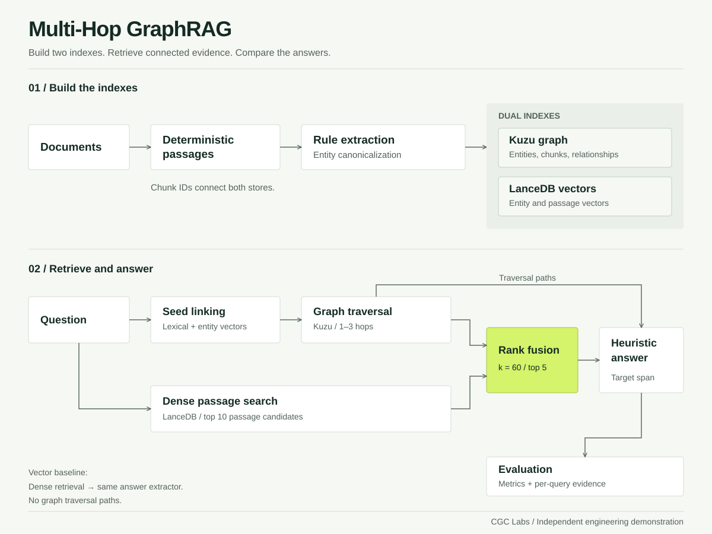
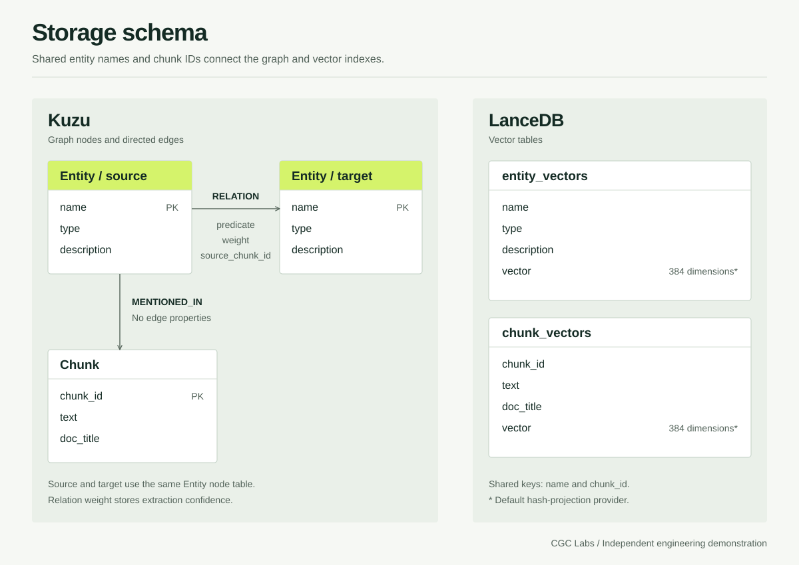

# Architecture & schema

Multi-Hop GraphRAG keeps passage similarity and entity relationships in separate local stores. The shared identifiers connect those stores during retrieval.

## Data flow

The vector baseline searches passages directly and uses the same answer extractor. It receives no graph traversal paths.

## Property graph

| Record | Stored fields | Role |
| :--- | :--- | :--- |
| `Entity` node | `name`, `type`, `description` | Canonical entity used for seed linking and traversal. |
| `Chunk` node | `chunk_id`, `text`, `doc_title` | Passage content and its document title. |
| `RELATION` edge | `predicate`, `weight`, `source_chunk_id` | Directed relationship with extraction confidence and passage provenance. |
| `MENTIONED_IN` edge | No properties | Links an entity to a passage that mentions it. |

`chunk_id` contains the first 16 hexadecimal characters of the passage's SHA-256 digest. It identifies normalized passage text, not the source document. Identical text can therefore share an ID across documents.

Relationship confidence ranges from zero to one. Traversal includes an edge when its weight is at least the configured threshold. The hybrid retriever uses **0.70**. Direct passages attached to a seed remain eligible without traversing an edge.

Relations are stored with a direction. Queries traverse them in either direction to handle questions that start at either endpoint. The traversal queries exclude repeated entity names within a path.

Entity aliases exist in the Python canonicalization model. The current graph and vector schemas do not persist the alias list.

## Vector tables

LanceDB stores two tables. The default embedding provider produces 384-dimensional vectors.

| Table | Stored fields | Search purpose |
| :--- | :--- | :--- |
| `entity_vectors` | `name`, `type`, `description`, `vector` | Candidate seed entities for query mentions. |
| `chunk_vectors` | `chunk_id`, `text`, `doc_title`, `vector` | Candidate passages for the question. |

The default provider hashes token and character features into normalized vectors. It is a deterministic local substitute for learned embeddings. It does not establish the semantic quality of a transformer model.

The methods named `upsert_chunks` and `upsert_entities` currently append records when a table exists. The benchmark starts with a fresh store; repeated incremental ingestion needs separate duplicate-handling work.

## Retrieval defaults

| Setting | Current value |
| :--- | :--- |
| Passage size | Up to 512 regex tokens |
| Passage overlap | 64 tokens |
| Minimum accepted passage | 10 tokens |
| Seed entities | Up to 3 |
| Graph depth | 1–3 hops |
| Edge confidence threshold | 0.70, inclusive |
| Traversal row limit | 20 per depth query |
| Vector passage candidates | 10 |
| Fused passages | 5 |
| Reciprocal rank fusion constant | 60 |

The chunker records `min_tokens=256`, but it accepts shorter documents that meet the 10-token validity minimum. It does not pad documents to 256 tokens.

For a passage appearing in either candidate list, reciprocal rank fusion adds `1 / (60 + rank)` for each list containing that passage. Ranks start at one. The five highest combined scores become the retrieved context.

The graph candidate set is not explicitly sorted before fusion. Its contribution to rank ordering should not be interpreted as a learned relevance score.

## Answer extraction

The default generator examines the retrieved traversal paths. It first ranks the terminal relationship against the question, then applies the existing depth and context scores. This lets a birthplace question reach the city while a founder question can stop at the person.

If no graph candidate is available, the extractor checks relational triples and capitalized phrases in the context. This fallback is limited and can select the wrong entity. Optional callable model adapters are available, but the CLI demonstration uses heuristic extraction.

## Evaluation

The runner compares both systems over the same questions and expected supporting passages.

| Metric | Definition in this project |
| :--- | :--- |
| All-support retrieval recall | Fraction of questions whose retrieved passages contain every expected supporting chunk. |
| MRR@5 | Mean reciprocal rank of the first expected supporting chunk within five results. |
| Exact match | Normalized predicted answer equals the normalized expected answer. |
| Token F1 | Token precision and recall combined as their harmonic mean. |
| Faithfulness proxy | Fraction of answer claims meeting the context-token overlap threshold. |

Answer normalization lowercases text, removes punctuation and English articles, and collapses whitespace. The faithfulness proxy uses a 70% token-overlap threshold. It cannot establish whether a statement is true or whether its citations support the full reasoning chain.

The checked-in report covers three built-in synthetic questions. Local JSONL and Hugging Face loading paths exist for further evaluation. No published MuSiQue validation result is included.

## Result exports

Each run writes a standalone HTML report and a versioned JSON envelope. The report embeds its data and original CGC Labs logo. Cabinet Grotesk and General Sans load through the official Fontshare stylesheets; system sans fonts serve as offline fallbacks. Font binaries are not redistributed. The [results schema](results.schema.json) describes the export fields. The [example JSON](example-results.json) contains an executed synthetic run.

The envelope records the UTC run time, dataset kind, document and sample counts, actual embedding provider, answer generator, aggregate metrics, and per-question evidence for both systems. Scores use proportions from zero to one. Rendering converts them to percentages.

Runtime validation also checks unique sample IDs, matching evaluation sets, record counts, and agreement between aggregates and their source records.

## Implementation boundaries

- Storage wrappers catch several database errors and can return partial results without raising them to the caller.
- Regex extraction and lexical entity linking have limited coverage for aliases and unfamiliar relations.
- The current schemas duplicate passage text between the graph and vector stores.
- The project has no service boundary, access-control layer, or tenant model.
- The benchmark rebuilds its selected database directory; use a disposable location.

These are current constraints, not claims that production hardening has been completed.
